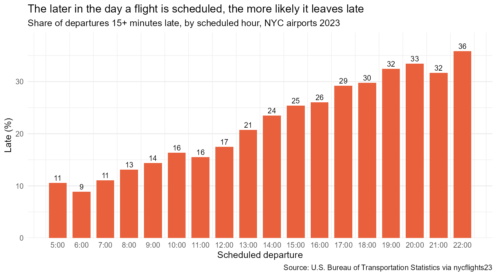
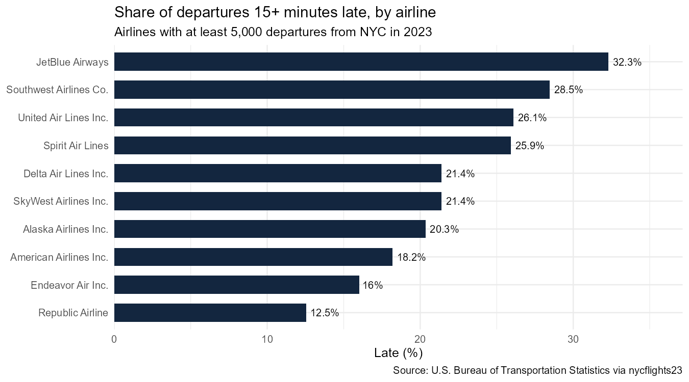
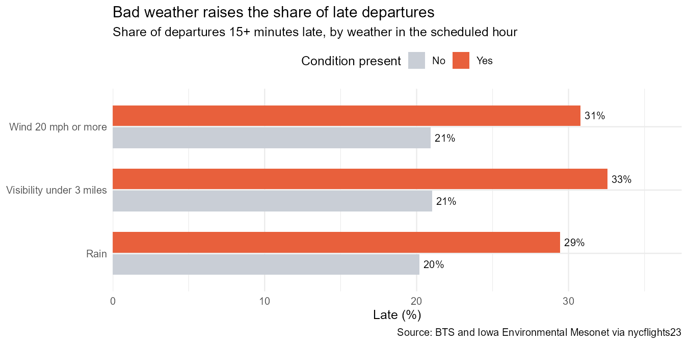
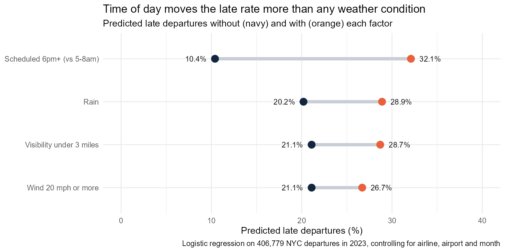

# NYC flight delays: time of day matters more than the weather

**Of 424,614 flights that left New York's three airports in 2023, 21.6% left 15 or more minutes late. With airline, airport, month and weather held constant, a logistic regression predicts 10.4% of flights would leave late if all were scheduled between 5 and 8am, against 32.1% if all left at 6pm or later. Rain adds 8.7 percentage points, but only 12% of flights left in rain.**

**Tools:** R (tidyverse, ggplot2, broom), logistic regression, Quarto

**Data:** every flight that left JFK, LaGuardia and Newark in 2023, from the [U.S. Bureau of Transportation Statistics](https://www.transtats.bts.gov/), with hourly airport weather from the Iowa Environmental Mesonet, via the [`nycflights23`](https://cran.r-project.org/package=nycflights23) R package

**Read the full report:** [ayanfedara.github.io/nyc-flight-delays/flight_delays.html](https://ayanfedara.github.io/nyc-flight-delays/flight_delays.html) | **Code:** [`flight_delays.qmd`](flight_delays.qmd)

---

## Business question

Late departures cost airlines crew time, missed connections and unhappy passengers. Which flights leaving New York leave late, and how much of that is down to the weather rather than things the airline controls?

## Findings

### 1. Delays build up through the day

8.9% of flights scheduled at 6:00 left late, against 32.5% at 19:00 and 35.8% at 22:00. The share of late departures rises almost every hour, which fits delays being carried forward as the same aircraft and crews fly several trips a day.

### 2. Airlines differ more than airports

Among the 10 airlines with at least 5,000 departures, the late rate ranged from 12.5% (Republic Airline) to 32.3% (JetBlue). LaGuardia (18.7%) did better than Newark (23.4%) and JFK (23.1%).

### 3. Bad weather raises the late rate, but it is rare

| Condition in the scheduled hour | Late without | Late with | Flights affected |
| --- | --- | --- | --- |
| Rain | 20.2% | 29.5% | 49,499 |
| Visibility under 3 miles | 21.0% | 32.6% | 10,636 |
| Wind 20 mph or more | 20.9% | 30.8% | 15,675 |

Out of 406,779 flights matched to weather.

### 4. With other factors held constant, time of day matters most

| If every flight... | Predicted late | Change |
| --- | --- | --- |
| was scheduled 5 to 8am | 10.4% | |
| was scheduled 6pm or later | 32.1% | +21.7 points |
| left in rain (vs dry) | 28.9% (vs 20.2%) | +8.7 points |
| left in visibility under 3 miles | 28.7% (vs 21.1%) | +7.6 points |
| left in wind of 20 mph or more | 26.7% (vs 21.1%) | +5.6 points |

In odds terms, an evening flight is 4.45 times as likely to leave late as an early-morning one (95% CI 4.33 to 4.57), against 1.69 for rain (1.65 to 1.73).

## Recommendation

- **Build more slack into the evening timetable.** Longer turnaround times or spare aircraft for afternoon and evening flights would stop morning delays spreading through the day; the timetable is something airlines control, the weather is not.
- **Plan for bad-weather days separately.** Rain, low visibility and strong wind each add 6 to 9 points to the late rate; forecasts a day ahead could trigger extra ground staff and earlier passenger warnings.
- **For travellers:** a morning flight is the most reliable choice, whatever the airline.

## Method

- **Data:** 435,352 scheduled departures; 10,738 cancelled flights (no departure time, 2.5%) are excluded from the late rate. A flight is late if it left 15 or more minutes after schedule (the U.S. Department of Transportation definition).
- **Weather:** each flight joined to its airport's weather in the scheduled hour; rain = any precipitation, low visibility = under 3 miles, strong wind = 20 mph or more.
- **Model:** logistic regression of late departure on time of day, airline (airlines under 5,000 flights grouped), airport, month, rain, low visibility and strong wind, fitted on 406,779 flights with complete weather. Results reported as odds ratios with 95% confidence intervals, and as average predicted late rates with each factor switched on and off for every flight.

## Limitations

- One year and three airports.
- Weather is measured at the departure airport only; storms elsewhere that delay the incoming aircraft are not included.
- The model shows associations, not the recorded cause of each delay.
- Cancelled flights are not counted as late, so the worst disruptions are left out.

## How to run it

See [GUIDE.md](GUIDE.md). Install the `nycflights23` package, open `nyc-flight-delays.Rproj` in RStudio, and render `flight_delays.qmd`.

---

Olorunmaiye Peter | [Portfolio](https://ayanfedara.github.io)
